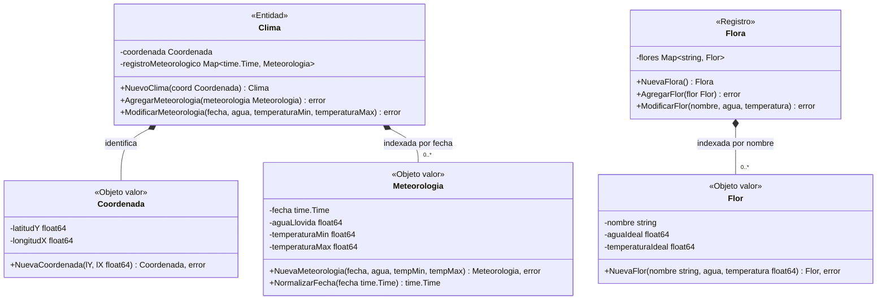

# Diagrama del modelo

Diagrama de las estructuras de datos implementadas en `internal/modelo`, generado a partir del código. La clasificación en entidad, objeto valor y registro es la definida en [modelo.md](modelo.md).

## Invariantes comprobadas en los constructores

| Tipo | Comprobación |
|---|---|
| `Coordenada` | `latitudY` en `[-90, 90]`; `longitudX` en `[-180, 180]` |
| `Flor` | `nombre` no vacío; `aguaIdeal > 0`; `temperaturaIdeal` en `[-50, 60]` |
| `Meteorologia` | `aguaLlovida >= 0`; `temperaturaMin <= temperaturaMax`; `temperaturaMin >= -273.15` |
| `Clima` | no se admiten dos meteorologías con la misma fecha |
| `Flora` | no se admiten dos flores con el mismo nombre |
